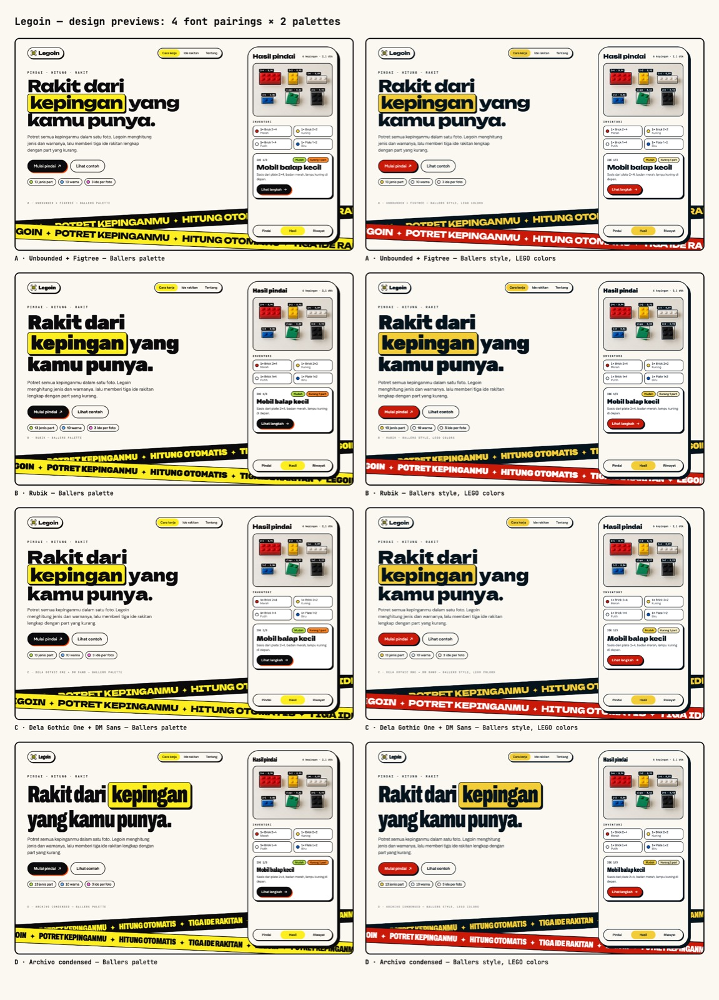

# ADR-0003: Ballers-Addict Style in LEGO Colors, with Dela Gothic One and the Name Legoin

- Status: Accepted
- Date: 2026-10-28
- Deciders: Legoin team
- Issue: #3
- Supersedes: [ADR-0002](0002-visual-direction.md)

## Context and Problem

[ADR-0002](0002-visual-direction.md) chose a calm "Buku instruksi" (instruction booklet) style with LEGO red and yellow, and the UI name BrickSense. The team then settled on two changes: the product is called **Legoin**, and the look should follow the team's [ballers-addict](https://github.com/al-dioooo/ballers-addict) site, with a different typeface. Which ballers-addict pieces carry over, which font replaces Bricolage Grotesque, and which palette sits on top?

## Decision Drivers

- Reuse a visual language the team already built and likes: loud, playful, comic-sticker energy that suits LEGO owners of all ages.
- A typeface of Legoin's own, not ballers-addict's Bricolage Grotesque.
- Keep the rules from ADR-0002 that separate the UI from detected brick colors.
- WCAG AA contrast for text and controls.

## Considered Options

All 8 combinations were rendered as previews, using the real fonts and a sample scan photo:

Fonts (display + text):

1. Unbounded + Figtree
2. Rubik
3. Dela Gothic One + DM Sans
4. Archivo condensed

Palettes on the ballers-addict style:

1. The ballers palette: ink primary with a blaze shadow, sun yellow, the artwork colors
2. LEGO colors: LEGO Red primary, LEGO Yellow highlight

## Decision

Option C with LEGO colors: **Dela Gothic One + DM Sans** on the **ballers-addict style**, with **LEGO Red and Yellow**.

What carries over from ballers-addict:

- Warm paper (#fbf8f1) under ink (LEGO Black #05131D).
- Ink outlines, plus hard offset shadows with no blur.
- Die-cut stickers.
- Film grain.
- Marquee tape bands.
- Spring and expo easing, with a hover tilt on buttons.

What's new or changes:

- **Type:** Dela Gothic One for display (one weight, never synthesized bold), DM Sans for text, and JetBrains Mono kept for counts, part ids and confidence.
- **Colors:** LEGO Red (`red-600`) is the primary action, and LEGO Yellow (`yellow-300`) is for stickers, step numbers and highlights. The LEGO-anchored OKLCH scales from ADR-0002 stay.
- **Name:** the product is **Legoin** in the UI and docs.

These rules carry over from ADR-0002:

- Detection boxes and their labels are ink with a white halo, never red.
- Brick colors are data: they paint real bricks only, always with the color name.
- Status is a dot plus a label.
- Destructive actions use an outlined button with confirmation.
- The logo (a yellow 2×2 brick in ink line art) uses no red.

One rule is new: grain never covers scan photos or inventories, where users judge brick colors.

## Consequences

- Positive: Legoin shares a family look with ballers-addict, and the sticker and tape language makes a playful demo.
- Positive: every text pair meets AA. White on LEGO Red is 5.8:1, ink on LEGO Yellow 12.1:1, and secondary text on paper 6.7:1.
- Negative: "Legoin" contains LEGO's trademark. That's acceptable for a course project, but it needs revisiting before any public or commercial launch.
- Negative: a red primary sits on top of red brick data. As in ADR-0002, the rules above, not hue, keep the two apart.
- Negative: Dela Gothic One has a single weight, so hierarchy comes from size and the DM Sans pairing, not from weight.
- Negative: grain and the marquee add motion; both stop under `prefers-reduced-motion`.

## Pros and Cons of the Options

### Unbounded + Figtree

- Pro: the loudest streetwear look.
- Con: the wide display wraps long Indonesian headlines onto more lines on phones.

### Rubik

- Pro: rounded like brick edges, and a single family to load.
- Con: softer, with less poster punch than the other options.

### Dela Gothic One + DM Sans

- Pro: blocky comic-poster headings that suit stickers and tape; DM Sans reads well in dense inventories.
- Con: the display face has one weight.

### Archivo condensed

- Pro: the closest to ballers-addict's condensed Bricolage.
- Con: too close to it to read as Legoin's own.

### Ballers palette vs LEGO colors

- Ballers palette, pro: the ink primary stays clear of brick hues.
- Ballers palette, con: it's ballers-addict's brand rather than Legoin's.
- LEGO colors, pro: instantly about bricks, and it keeps the LEGO-anchored scales.
- LEGO colors, con: red and yellow overlap with detected colors, so the rules above have to hold the line.

## References

- [ballers-addict](https://github.com/al-dioooo/ballers-addict), the source style
- [ADR-0002](0002-visual-direction.md), superseded
- `DESIGN.md` and `/desain` in [legoin-web](https://github.com/al-dioooo/legoin-web)
